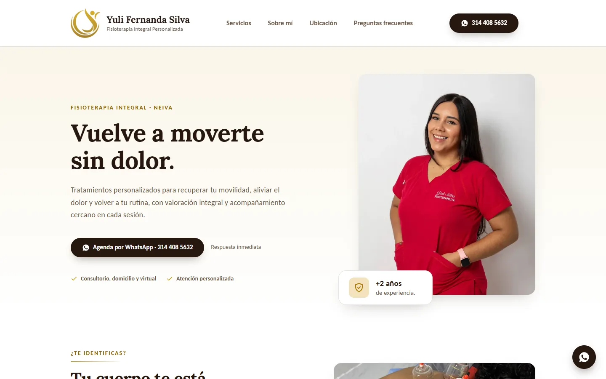
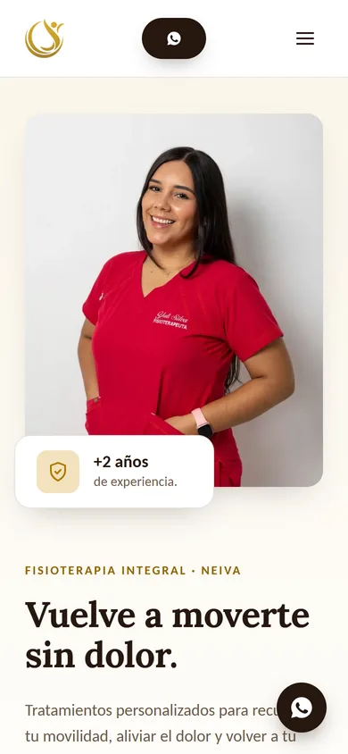

# Fisioterapia Integral · Yuli Fernanda Silva

Landing page profesional para una fisioterapeuta independiente en Neiva (Colombia), en producción en **[fisioyuli.com](https://fisioyuli.com)**.

Su objetivo es convertir visitas en pacientes: agendar por WhatsApp en un toque, mostrar servicios, consultorio y reseñas reales de Google, y aparecer en las búsquedas locales.


<p align="center">
  
  &nbsp;
  
</p>

## Resultados

Medido con **PageSpeed Insights** (servidores de Google) sobre el sitio publicado:

| | Rendimiento | Accesibilidad | Buenas prácticas |
|---|:---:|:---:|:---:|
| Móvil | **94** | **100** | **100** |
| Escritorio | **100** | **100** | **100** |

- CLS de 0 y LCP de unos 3 s en la simulación de 4G lento de Lighthouse (0.3–0.8 s de primer pintado en una carga real).
- Sitemap leído por Google Search Console sin errores.
- Sin cookies: la analítica es Cloudflare Web Analytics, que mide visitas de forma agregada y anónima.

## Stack

| Área | Elección | Por qué |
|---|---|---|
| Framework | **Angular 22**: standalone components, signals, control flow `@if`/`@for`, `@defer` | API moderna, sin NgModules |
| Renderizado | **SSG puro** con `@angular/ssr` (`outputMode: "static"`, `RenderMode.Prerender`) | HTML completo desde el primer byte, sin servidor en producción |
| Hidratación | **Incremental** (`withIncrementalHydration` + `@defer (hydrate on viewport)`) | El JS de cada sección se descarga solo cuando entra en pantalla |
| Formularios | **Signal Forms** (`@angular/forms/signals`) | La API de formularios basada en signals de Angular 22 |
| Estilos | SCSS + CSS custom properties como design tokens | Sin Tailwind ni Angular Material: ~10 componentes no lo justifican |
| Hosting | **Cloudflare Pages** | HTTPS, CDN global y una preview por rama, sin costo |

Solo usa dependencias de Angular, sin librerías de UI ni de carruseles. El carrusel de reseñas usa `scroll-snap` nativo de CSS.

## Decisiones técnicas destacadas

- **Contenido separado del código.** Todo el texto, los servicios, horarios, reseñas y datos SEO viven en un solo archivo tipado ([`site-content.ts`](src/app/data/site-content.ts) + [`site-content.model.ts`](src/app/data/site-content.model.ts)). Ningún componente tiene texto escrito a mano, así que adaptar la plantilla a otro profesional de salud es editar ese archivo y los tokens de color.
- **SEO local.** Title, meta y Open Graph por página, URL canónica, imagen para redes de 1200×630, `sitemap.xml` y datos estructurados JSON-LD de tipo `MedicalBusiness`, todo prerenderizado en el HTML.
- **Rendimiento.**
  - Fuentes de marca autoalojadas (subconjunto latino, `preload` solo de las que se ven en la primera pantalla) en vez de Google Fonts.
  - Imágenes WebP con `NgOptimizedImage` y dimensiones explícitas; `priority` solo en la foto principal.
  - Hidratación incremental para reducir el JavaScript inicial.
- **Accesibilidad (WCAG 2.1 AA).**
  - Contraste mínimo de 4.5:1. El dorado de la marca se oscureció (`--color-gold-text`) para el texto pequeño.
  - Un solo `<h1>`, navegación por teclado con foco visible, `aria-label` en los controles con solo icono y texto alternativo descriptivo en las imágenes.
  - Animaciones que respetan `prefers-reduced-motion`.
- **Privacidad y normativa (Ley 1581 de 2012, Colombia).**
  - Página de política de tratamiento de datos.
  - Sin cookies ni rastreadores de terceros.
  - Las reseñas se copian textuales de Google, y las fotos de perfil solo se usan con permiso, guardadas en el propio sitio y no enlazadas a Google.
- **Marca real.** La paleta y la tipografía (Lora + Carlito) salen del brandbook de la cliente, con sus valores CMYK convertidos a hex.

## Secciones

Header con menú móvil · Hero · "¿Te identificas?" · Servicios · Sobre mí (formación y trayectoria) · Consultorio (galería) · Testimonios (reseñas de Google en carrusel) · Ubicación (mapa ilustrado en SVG + "Cómo llegar") · Preguntas frecuentes · Footer · Botón flotante de WhatsApp · Página de política de datos.

## Estructura

```
src/app/
├── core/       → seo.ts (title, meta, canonical, JSON-LD) · whatsapp-link.util.ts
├── shared/     → ui/ (button, section-header, icon, accordion, whatsapp-fab…) · directives/reveal-on-scroll
├── sections/   → header, hero, pain-points, services, about, space, testimonials, location, faq, footer
├── pages/      → home (orquesta las secciones) · privacy-policy
└── data/       → site-content.model.ts (tipos) · site-content.ts (contenido)
public/         → images/ · fonts/ · robots.txt · sitemap.xml · _headers
```

## Correr el proyecto

Requiere Node `^22.22.3` o `^24.15.0` (ver [`.nvmrc`](.nvmrc)).

```bash
npm install
npm start        # servidor de desarrollo en http://localhost:4200
npm run build    # sitio estático en dist/fronted-landing-fisio/browser/
```

## Flujo de despliegue

| Rama | Se publica en | Uso |
|---|---|---|
| `develop` | `develop.yuli-fisioterapia.pages.dev` (no indexable) | Trabajo diario; la cliente revisa los cambios aquí |
| `main` | [fisioyuli.com](https://fisioyuli.com) | Producción; solo recibe merges de `develop` aprobados |

Cada push hace que Cloudflare Pages compile y publique la rama correspondiente. El espejo `*.pages.dev` responde `X-Robots-Tag: noindex` (vía [`public/_headers`](public/_headers)) para que Google indexe solo el dominio propio.

El proceso completo por fases, de descubrimiento a producción, está documentado en [`docs/PLAN.md`](docs/PLAN.md).

## Autor

Desarrollado por **Jhon Mario Rodriguez**: [GitHub @jhonmario7](https://github.com/jhonmario7).

## Licencia

Proyecto desarrollado para **Yuli Fernanda Silva · Fisioterapia Integral**. El diseño, los textos y las imágenes pertenecen a la cliente; el código se muestra como ejemplo de trabajo y no se autoriza su reutilización sin permiso.
